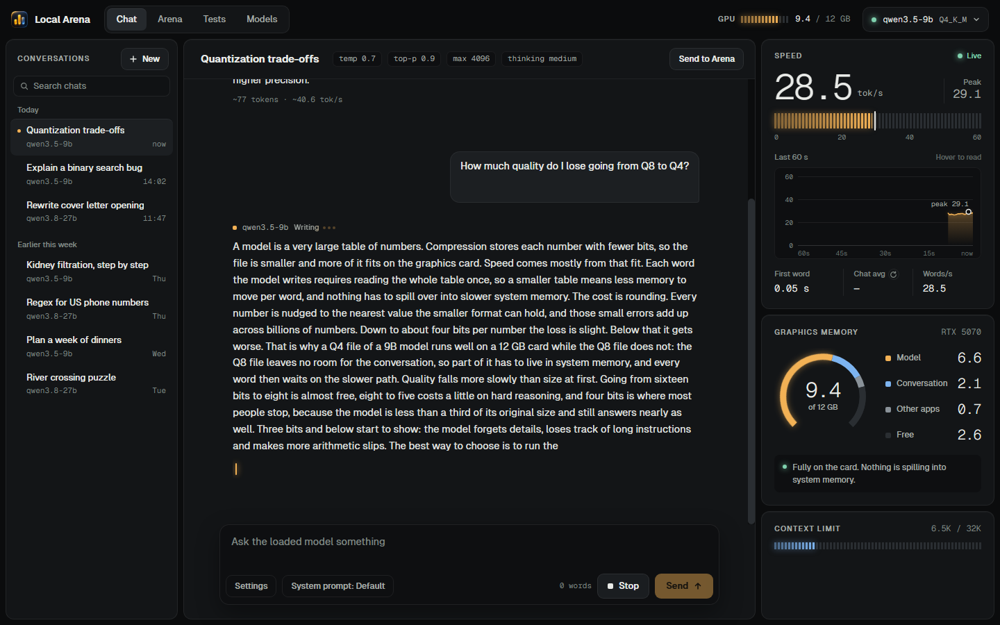
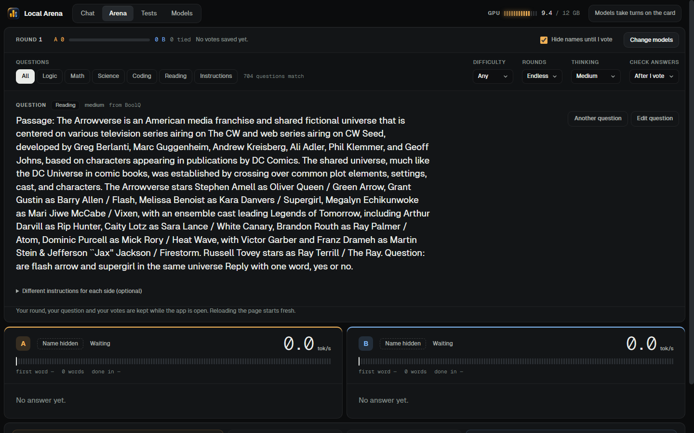
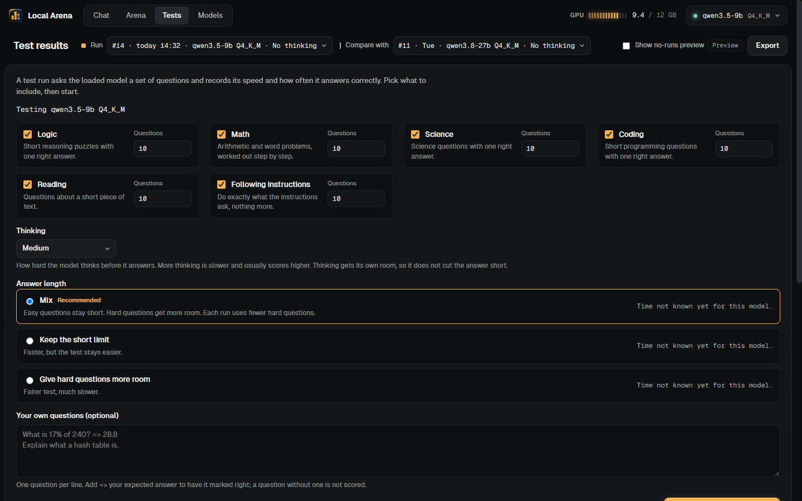
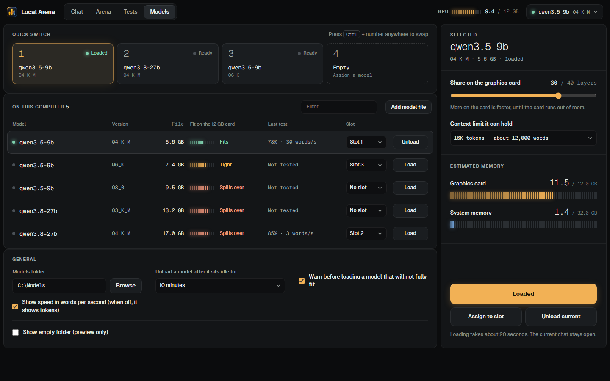

# Local Arena

Local Arena is a local web app for chatting with, comparing and testing language models that run on your own PC. It talks to any OpenAI-compatible server, such as llama-server, LM Studio or Ollama, and keeps all data on your machine.



The screenshots show demo mode, which fills the app with sample data and needs no model.

## The four screens

**Chat** streams answers and reasoning, shows speed and graphics memory while the model writes, and saves every conversation.

**Arena** puts two models, or two sets of instructions, side by side on the same question. You vote without seeing which model wrote which answer. Names appear after the vote.



**Tests** runs a model against 704 benchmark questions (logic, math, science, coding, reading, following instructions) and grades the answers by rule. You can add your own questions. Runs are saved so you can compare two models or two settings.



**Models** lists the models on your PC, shows whether each fits your graphics card, loads and unloads them, and keeps settings per model. You can add a model file, or connect a server that is already running.



Test scores come from selected questions and exact grading rules. They are useful for comparing models on your own PC. They are not official leaderboard results.

## Requirements

- Windows 10 or 11. Windows is the tested platform. The Python server runs elsewhere, but the model launchers and GPU readings are Windows-specific.
- Python 3.10 or newer. The server uses only the standard library, so there is nothing to install.
- A current web browser to open the app.
- To load models from Local Arena: a GGUF model file and a `llama-server` program from [llama.cpp](https://github.com/ggml-org/llama.cpp), or a server you already run.
- Optional: `nvidia-smi` for graphics memory readings. Chat works without it.
- Only for the test suite: Node.js 22 or newer, and Chrome or Edge.

A 12 GB graphics card is what the layout was designed around. You do not need one to try the app.

## Install and first run

1. Download or clone this repository. There is no install step.
2. In a terminal in the repository folder, run:

   ```powershell
   python server.py
   ```

3. Open <http://127.0.0.1:8790> in your browser.

The server listens on `127.0.0.1` only. It has no accounts and sends nothing to the internet.

**Try it without a model.** Open <http://127.0.0.1:8790/?sim=1> for demo mode. It uses sample data and saves nothing. To see real streaming, start the bundled test engine, which writes made-up replies, and point Local Arena at it. In one terminal:

```powershell
python tools/fake_engine.py --port 8766
```

In another:

```powershell
$env:ARENA_ENGINE = "127.0.0.1:8766"
python server.py
```

**Use a real server.** Start any OpenAI-compatible server on `127.0.0.1:8080`, or set `ARENA_ENGINE` to its address, and then run `python server.py`. Local Arena finds the loaded model by itself.

**Optional Windows shortcut.** `pythonw tools/arena_app.pyw` starts the server without a console window if it is not running, and opens Local Arena in an Edge or Chrome app window. `pythonw tools/arena_app.pyw stop` stops the server. This launcher also turns on model switching (see below).

## Add your own models

Open the Models screen and choose **Add model**. There are three ways:

- **On this PC.** Local Arena scans the usual folders for `.gguf` files and lists what it finds. These are the LM Studio and Hugging Face folders, the llama.cpp cache, and `models` and `Downloads` in your user folder.
- **From a path.** Paste the path to any `.gguf` file.
- **Running server.** Connect to LM Studio, Ollama or a `llama-server` that is already running. Local Arena connects without starting or stopping it.

For a model file, Local Arena needs a `llama-server` program. It lists the ones it finds, or you can paste the path to `llama-server.exe`. You can set layers on the graphics card, context size and extra flags for each model.

Loading and unloading models from Local Arena is off until you start the server with `ARENA_SWITCH_REAL=1`:

```powershell
$env:ARENA_SWITCH_REAL = "1"
python server.py
```

Loading a model stops the model Local Arena started before it, so only one big model uses the card. Local Arena stops only the processes it started itself. Servers you run yourself are left alone. Details are in [docs/SWITCHING.md](docs/SWITCHING.md).

## How the model catalogue works

Local Arena builds its model list from three sources:

1. `data/user-models.json`. Models you add in the app are stored here. This is the normal route and needs no editing.
2. `config/models.json`, or the file named by `ARENA_MODELS`. This is an optional hand-written list for models that start through your own launcher scripts. A fresh clone has none, and Local Arena falls back to `config/models.example.json`, which is empty. Copy the example to `config/models.json` to start your own list. The file is ignored by git.
3. `config/launcher.local.json`. This optional, git-ignored file holds paths for launcher scripts (`strataHome`, `bonsaiHome`, `familyStop`, `ninferLaunch`, `minicpmHome`). The environment variables `ARENA_STRATA_HOME`, `ARENA_BONSAI_HOME`, `ARENA_FAMILY_STOP`, `ARENA_NINFER_LAUNCH`, `ARENA_MINICPM_HOME` and `ARENA_NINFER_DISTRO` do the same.

Most people only need the first source.

## Settings and saved data

| Variable | Default | Purpose |
| --- | --- | --- |
| `ARENA_PORT` | `8790` | Port the app listens on (loopback only) |
| `ARENA_ENGINE` | `127.0.0.1:8080` | Address of the model server |
| `ARENA_STORE` | `data/store` | Chats, votes, runs and settings |
| `ARENA_MODELS` | `config/models.json`, then the example | Catalogue file |
| `ARENA_LIVE` | `data/live` | Logs and the plain-text live record |
| `ARENA_SWITCH_REAL` | unset | Set to `1` to let Local Arena load and unload models |

Everything Local Arena saves is under `data/` and is ignored by git. Copy that folder to back up your chats, votes and test runs. Graphics memory splits and token counts are estimates. Speed uses the token count from the engine when it supplies one.

## Tests

```powershell
python tools/verify.py
```

This compiles the Python, syntax-checks the JavaScript, runs the unit and gateway tests and drives the whole interface in a headless browser against a fake engine. Nothing loads a real model or uses the GPU. A full run takes several minutes. If you run it next to another copy of Local Arena, set `ARENA_PORT_OFFSET=300` (or another multiple of 100) so the test ports do not collide.

Run one browser check with `node tools/ui_check.mjs --only 61-tests-run`, or list them with `node tools/ui_check.mjs --list`. See [docs/TESTING.md](docs/TESTING.md) for the full list.

## More documentation

- [docs/ARCHITECTURE.md](docs/ARCHITECTURE.md) is the code map.
- [docs/API.md](docs/API.md) describes the gateway routes.
- [docs/TESTING.md](docs/TESTING.md) covers the test suite.
- [docs/GRADING.md](docs/GRADING.md) explains how answers are graded.
- [docs/ACCEPTANCE.md](docs/ACCEPTANCE.md) is the manual checklist for real models and a real GPU.
- [CHANGELOG.md](CHANGELOG.md) lists what changed in each version.
- [docs/ROADMAP.md](docs/ROADMAP.md) lists what is planned next.

## Licence

Local Arena is released under the [MIT licence](LICENSE).

The benchmark questions come from public datasets, and each question file records its source, licence and any edits. Some of those licences, such as CC BY-SA, require attribution and share-alike. Fonts are under their own licences. See [THIRD_PARTY_NOTICES.md](THIRD_PARTY_NOTICES.md) and `docs/licenses/`.
